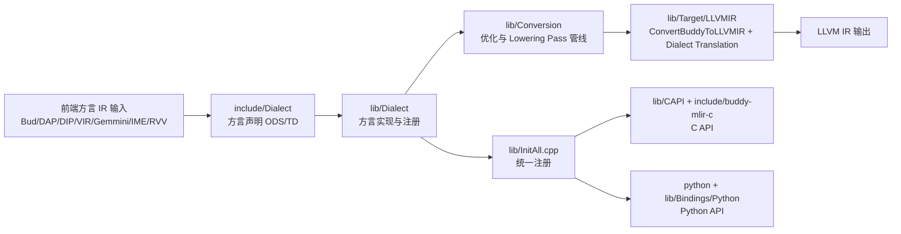

# Buddy-MLIR Midend 结构与编译流水线

本文整理两部分内容：
1. Midend 目录结构与职责（上次内容汇总）
2. 从前端方言到 LLVM IR 的调用链与流水线图（本次内容）

## 1. Midend 目录结构与职责

## 1.1 顶层目录

- `midend/CMakeLists.txt`
  - Midend 总入口，组织 include、lib，并在开启 Python 绑定时添加 python 子目录。
- `midend/include/`
  - 对外头文件与 TableGen/ODS 声明层。
- `midend/lib/`
  - 中端核心实现层（Dialect、Conversion、Target、CAPI、Utils）。
- `midend/python/`
  - Python 绑定声明与构建入口。

## 1.2 include 层

- `midend/include/Dialect/`
  - 各方言声明（Bud、DAP、DIP、RVV、VectorExp、Gemmini、IME、GPU、VIR）。
  - 典型内容：`*Dialect.td`、`*Ops.td`、`*Dialect.h`、`*Ops.h`、`CMakeLists.txt`。
- `midend/include/Target/LLVMIR/`
  - 面向 LLVM IR 的翻译声明。
  - 典型内容：Gemmini/IME/RVV 到 LLVM IR 的 translation 头文件。
- `midend/include/Utils/`
  - 通用工具声明（仿射变换、DAP/DIP/GPU 工具等）。
- `midend/include/buddy-mlir-c/`
  - C API 对外头文件（Dialects、InitAll、RegisterEverything）。

## 1.3 lib 层

- `midend/lib/Dialect/`
  - 方言实现层。
  - 典型内容：`*Dialect.cpp`、`*Ops.cpp`、`*Attrs.cpp`、`*Types.cpp`。
- `midend/lib/Conversion/`
  - Pass 与降级/优化实现层。
  - 典型内容：`Lower*`、`*Optimization`、`LinalgToVIR`、`VIRToVector`、`FuncBufferize`、`MLIRGPU`、`TosaElementwiseFusion` 等。
- `midend/lib/Target/LLVMIR/`
  - 导出 LLVM IR 的实现层。
  - 典型内容：`ConvertBuddyToLLVMIR.cpp` 及各方言 translation 实现。
- `midend/lib/CAPI/`
  - C API 实现层，打通 C/C++/Python 侧注册与调用。
- `midend/lib/Utils/`
  - 工具实现层，对应 include/Utils。
- `midend/lib/Bindings/Python/`
  - Python 扩展模块侧的注册实现。
- `midend/lib/InitAll.cpp`
  - 全量注册入口聚合实现。

## 1.4 python 层

- `midend/python/CMakeLists.txt`
  - Python 模块构建入口，声明各 dialect 的绑定。
- `midend/python/buddy_mlir/dialects/`
  - Python 方言绑定定义。
  - 典型内容：`*Binding.td` + 对应 `*.py`。

## 2. 从前端方言到 LLVM IR 的调用链

## 2.1 总体流程

1. 前端生成或导入 Buddy 方言 IR（Bud/DAP/DIP/VIR/Gemmini/IME/RVV 等）。
2. Dialect 声明层（include）定义语义，Dialect 实现层（lib/Dialect）提供运行时行为。
3. Conversion Pass 管线对 IR 做规范化、优化、向目标方言降级。
4. Target/LLVMIR 翻译层把中端方言转换为 LLVM IR 表达。
5. CAPI/Python 侧通过 RegisterEverything/InitAll 暴露统一入口。

## 2.2 目录映射版调用链

## 2.3 关键文件锚点（便于跟代码）

- 管线聚合与链接入口：`midend/lib/CMakeLists.txt`
- Conversion 子管线总入口：`midend/lib/Conversion/CMakeLists.txt`
- Dialect 子模块总入口：`midend/lib/Dialect/CMakeLists.txt`
- LLVM IR 目标总入口：`midend/lib/Target/LLVMIR/ConvertBuddyToLLVMIR.cpp`
- C API 聚合入口：`midend/lib/CAPI/RegisterEverything.cpp`
- Python 绑定构建入口：`midend/python/CMakeLists.txt`

## 2.4 典型 Pass 路径示例（概念级）

示例路径（会按模型和目标硬件选择具体分支）：

1. 输入方言/标准 MLIR 方言
2. 图优化与算子融合（如 GraphRedundancyElimination、TosaElementwiseFusion）
3. 算子优化与向量化（如 MatMulOptimization、ConvOptimization、DAPVectorization）
4. 目标相关 Lowering（如 LowerGemmini、LowerIME、LowerRVV）
5. Target/LLVMIR Translation
6. 产出 LLVM IR

说明：具体 pass 顺序由构建配置和驱动管线决定，以上是与当前目录结构一致的逻辑映射。
