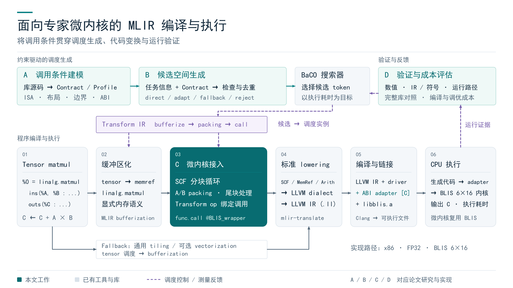

# AI 编译器面试：从 matmul MLIR 到实际运行

展示版沿一段程序的完整编译链展开：**tensor matmul → bufferization → packing/fringe 与调用绑定 → LLVM dialect / LLVM IR → 原生编译链接 → CPU 运行**。论文的调用知识、候选生成、适配实现和联合验证标在相应位置。



展示版精简了框内文字，去掉面向讲述者的提示，并突出微内核接入环节，适合直接投屏或放入 PPT。原完整编译链图及其源文件保留，供备讲和技术追问时查阅。两版使用相同的六阶段主链与 A/B/C/D 贡献标记，可共用讲解稿。

| 文件 | 用途 |
| --- | --- |
| [thesis_architecture_present.png](thesis_architecture_present.png) | 展示版，3840×2160、16:9，用于面试投屏或插入 PPT |
| [thesis_architecture_present.pdf](thesis_architecture_present.pdf) | 展示版单页矢量 PDF，嵌入中文字体 |
| [thesis_architecture_present.svg](thesis_architecture_present.svg) | 展示版矢量轮廓 SVG，跨设备不依赖本机中文字体 |
| [draw_architecture_present.py](draw_architecture_present.py) | 展示版独立绘图源代码，生成时检查原图未被修改 |
| [thesis_architecture.png](thesis_architecture.png) · [PDF](thesis_architecture.pdf) · [SVG](thesis_architecture.svg) | 原完整编译链图，保留全部说明文字，未覆盖 |
| [talk_track.md](talk_track.md) | 30 秒介绍、约 3 分钟完整链路讲解、最小 MLIR 输入、阶段产物、尾块案例和追问 |
| [draw_architecture.py](draw_architecture.py) | 原完整编译链图的绘图源代码，未修改 |
| [thesis_overview.png](thesis_overview.png) · [PDF](thesis_overview.pdf) · [SVG](thesis_overview.svg) | 上一版四模块总览，保留用于补充说明研究组织 |
| [draw_overview.py](draw_overview.py) | 上一版四模块总览的绘图源代码 |

讲图先沿中间 **①→⑥** 说明同一个程序如何从 tensor 语义变成可执行文件。走到②③时解释上方 Transform 调度如何控制变换；走到⑤⑥时说明 adapter 和真实微内核如何连接；最后讲 D 的验证与反馈。A/B 回答“怎样得到可接纳候选”，C 对应编译器与 ABI 实现，D 回答“怎样确认调用成立并衡量收益”。

主线以实际贯通的 **BLIS f32 6×16、x86 路径** 为例，完整入口为 [run_integrated_pipeline.py](../../experiments/chapter4_5_integrated/scripts/run_integrated_pipeline.py)。Transform IR 是控制 payload 变换的程序；`llvm.mlir` 是 MLIR 的 LLVM dialect，`kernel.ll` 才是导出的 LLVM IR。图中 packing pass 生成循环与边界代码，专用 Transform op 绑定已准备的占位调用，C++ adapter 在原生构建时链接并在运行时连接 BLIS ABI。

Fallback 从 tensor 输入分支，依次进行 **tiling → 可选 vectorization → bufferization → 标准 lowering**，绕开 BLIS packing 与 wrapper。BLIS f64 复用核心生成逻辑；OpenBLAS RVV 共享 Contract 语义，保留包内生成与适配实现。这些扩展范围留在备讲材料中，展示版以 BLIS f32 路径为例。

图中青色表示论文方法与实现，灰色表示输入和复用组件，紫色虚线表示调度控制或测量反馈。Bufferization、MLIR/LLVM、Clang、BaCO 和专家微内核均为复用组件。正式固定预算评价的部分轨迹读取冻结实测语料；实际编译执行贯通见 [集成报告](../../experiments/chapter4_5_integrated/reports/integrated_results.md)，不能把所有调优反馈都说成逐次重新编译实测。

研究结果依据为当前论文第 3—5 章与 [Contract 空间验证数据](../../experiments/chapter6_contract_space_validation/processed/summary.json)。讲稿中的 2,600→104.4 是静态空间统计，1,256 是既有实测 case 的路径核对，两者需分别说明。是否用于部署仍以完整库对照和成本评价为准。

在仓库根目录重新生成展示版：

```bash
python documents/interview/draw_architecture_present.py
```

重新生成原完整编译链图：

```bash
python documents/interview/draw_architecture.py
```

重新生成上一版总览：

```bash
python documents/interview/draw_overview.py
```

依赖为 PyMuPDF 和工程已有的 `nwputhesis/fonts/simhei.ttf`。绘图不重跑硬件实验；脚本检查文字宽度与字形并输出布局检查记录，连线和层次另需目视检查。
