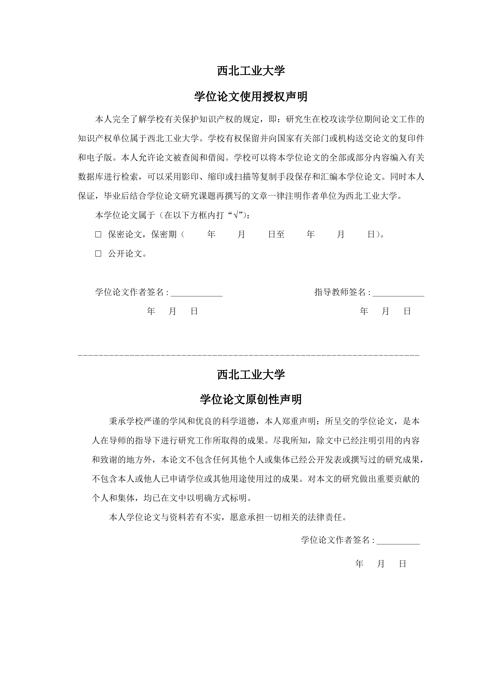
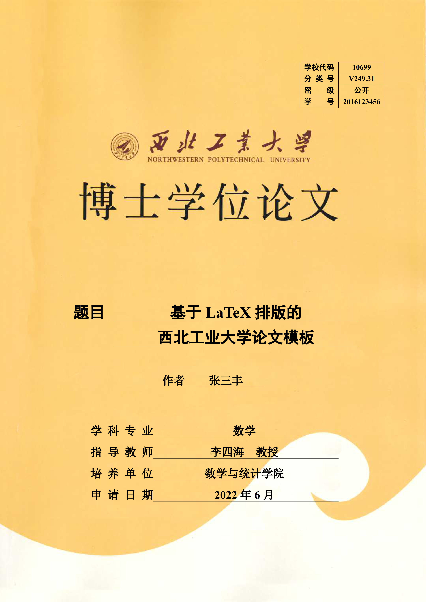
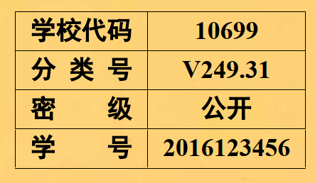

# LaTeX-Template-for-NPU-Thesis-2025

#### 介绍
根据[**Yet Another NPU Thesis Template**](https://github.com/NWPUMetaphysicsOffice/Yet-Another-LaTeX-Template-for-NPU-Thesis)的西北工业大学LaTex模板修改而成。

增加了封面、声明、中图分类号、最后一页。这样生成后替换声明页的扫扫描文件就能直接上传了[^1]。

#### 修改内容
- 按照《西北工业大学研究生学位论文写作指南（2025版）》修改了最后的声明书，改为最新版本。


- 封面增加指导老师的职称

| latex | pdf |
| :----: | :----: |
| \protitle{教授} |  |

- 封面增加博士学位论文背景


- 封面增加中图分类号设置

| latex | pdf |
| :----: | :----: |
| \categorynumber{V249.31}  |  |

- 增加最后一页


#### 使用方法
本仓库本身就是一个可以直接编译的西北工业大学学位论文 LaTeX 样例工程。推荐先从
`nputhesis-sample.tex` 改起，确认可以生成 PDF 后，再逐步替换成自己的论文内容。

##### 1. 准备环境

- 安装 TeX Live 2021 或更新版本（Windows 也可以使用 TeX Live 自带的 TeXworks）。
- 编译引擎使用 `XeLaTeX`，参考文献使用 `BibTeX`。
- 如果安装了 `latexmk`，可以用一条命令自动完成多轮编译；没有 `latexmk` 时按下面的手动命令顺序编译。
- 字体需要能被 XeLaTeX 找到。样例默认使用 `winfonts=true`，适合装有宋体、黑体、楷体、仿宋、Times New Roman、Consolas 的 Windows 环境；macOS/Linux 如果报字体缺失，可改掉 `winfonts=true`，安装相应中文字体，或在 `nputhesis.cls` 中调整字体名称。

##### 2. 从样例开始写论文

进入模板目录：

```bash
cd /buddy-mlir/jlq/thesis/latex-template-for-npu-thesis-2025
```

建议先复制一份样例文件，保留原始示例作参考：

```bash
cp nputhesis-sample.tex thesis.tex
```

之后主要编辑 `thesis.tex`。如果直接使用原文件，也可以继续编辑
`nputhesis-sample.tex`。

##### 3. 设置论文类型和字体

在 `.tex` 文件开头选择合适的 `documentclass`：

```tex
\documentclass[lang=chs, degree=phd, blindreview=false, winfonts=true]{nputhesis}
```

常用选项如下：

| 选项 | 说明 |
| --- | --- |
| `lang=chs` | 中文论文 |
| `degree=phd` | 博士论文 |
| `degree=master` | 硕士论文 |
| `degree=bachelor` | 本科论文 |
| `blindreview=false` | 正常版本 |
| `blindreview=true` | 盲评版本 |
| `winfonts=true` | 强制使用 Windows 常见字体 |
| `adobe=true` | 使用 Adobe 中文字体，需要本机已安装对应字体 |

##### 4. 填写论文基本信息

在“基本信息录入”部分修改标题、作者、学院、专业、导师、导师职称、中图分类号等字段：

```tex
\title{中文标题}{English Title}
\author{\blindreview{中文姓名}}{\blindreview{English Name}}
\date{2025年6月}{Jun 2025}
\school{学院中文名}{School Name}
\major{专业中文名}{English Major}
\advisor{\blindreview{导师中文名}}{\blindreview{Advisor Name}}
\protitle{教授}{Professor}
\categorynumber{V249.31}
\studentnumber{学号}
\funding{中文基金信息}{English funding information}
```

如果没有基金资助，可以将 `\funding` 的内容留空，或按学院要求删除/调整。

##### 5. 编写正文内容

文档结构已经在样例中搭好：

- `\frontmatter`：封面、标题页、中英文摘要、目录。
- `\mainmatter`：正文，从 `\chapter{...}` 开始写各章内容。
- `\bibliography{reference}`：参考文献，默认读取 `reference.bib`。
- `\appendix`：附录。
- `\backmatter`：致谢、参加科研情况、知识产权与原创性声明、末页。

常用写作方式可以直接参考 `nputhesis-sample.tex` 中的示例，包括公式、图、表、代码、
引用、附录和符号说明。

##### 6. 编译生成 PDF

如果使用复制后的 `thesis.tex`，推荐：

```bash
latexmk -xelatex thesis.tex
```

如果没有 `latexmk`，手动执行：

```bash
xelatex thesis.tex
bibtex thesis
xelatex thesis.tex
xelatex thesis.tex
```

如果继续使用样例文件，则把命令中的 `thesis` 换成 `nputhesis-sample`：

```bash
xelatex nputhesis-sample.tex
bibtex nputhesis-sample
xelatex nputhesis-sample.tex
xelatex nputhesis-sample.tex
```

编译成功后会生成同名 PDF，例如 `thesis.pdf` 或 `nputhesis-sample.pdf`。

##### 7. 参考文献

参考文献条目放在 `reference.bib` 中，正文里使用：

```tex
\cite{文献key}
```

样例默认使用：

```tex
\bibliographystyle{nputhesis-noslash}
\bibliography{reference}
```

其中 `nputhesis-noslash.bst` 是本仓库提供的改进格式；如需原始 GB/T 7714-2015 样式，
可改为 `\bibliographystyle{nputhesis}`。

##### 8. 盲评版本

需要生成盲评版本时，将文档类选项改为：

```tex
\documentclass[lang=chs, degree=phd, blindreview=true, winfonts=true]{nputhesis}
```

模板提供三种盲评标记：

| 命令 | 效果 |
| --- | --- |
| `\blindreview{text}` | 盲评时替换为空白 |
| `\blackbox{text}` | 盲评时替换为黑色块 |
| `\markname{text}` | 盲评时替换为 `***` |

作者、导师、致谢中的姓名等敏感信息建议用这些命令包起来。正常版本下会显示原文。

##### 9. 学位论文评阅人和答辩委员会

样例中已经给出了 `\makeCommitteePage{...}`。盲评专家人数可用：

```tex
\reviewers{\fullBlindReview{5}}
```

明审专家可用：

```tex
\reviewers{
    \expert{专家姓名}{职称}{单位}
}
```

答辩委员会使用：

```tex
\committee{2025 年 x 月 y 日}{
    \defenseChair{主席姓名}{职称}{单位}
    \committeeMember{委员姓名}{职称}{单位}
    \defenseSecretary{秘书姓名}{职称}{单位}
}
```

##### 10. 重要文件说明

| 文件 | 用途 |
| --- | --- |
| `nputhesis-sample.tex` | 完整论文示例，也是推荐的起始模板 |
| `nputhesis-sample.pdf` | 示例编译结果 |
| `nputhesis.cls` | 论文模板类文件，控制封面、页眉页脚、字体、章节格式等 |
| `reference.bib` | BibTeX 参考文献数据库 |
| `nputhesis.bst` | GB/T 7714-2015 参考文献样式 |
| `nputhesis-noslash.bst` | 改进版参考文献样式 |
| `background.pdf` | 博士论文封面背景 |
| `lastpage.pdf` | 论文最后一页背景 |
| `doc/` | README 中展示效果用的截图 |
| `西北工业大学研究生学位论文写作指南（2025版）.docx` | 格式规范参考文件 |

`nputhesis.cls`、`.bst`、`background.pdf`、`lastpage.pdf` 需要和主 `.tex` 文件保持可访问；
如果移动文件，请同步修改 `.tex` 或类文件中的路径。

##### 11. 常见问题

- `Font ... not found`：字体没有安装或字体名不一致。优先检查 `winfonts=true` 是否适合当前系统。
- 目录、引用或参考文献没有更新：重新执行完整的 `XeLaTeX -> BibTeX -> XeLaTeX -> XeLaTeX` 编译流程，或使用 `latexmk -xelatex`。
- 中文无法正常显示：确认使用的是 `XeLaTeX`，不是 `pdfLaTeX`。
- 最终提交需要签字扫描声明页时：先生成完整 PDF，再按学院/研究生院要求替换对应声明页。


[^1]: 今年刚好赶上更新了学位论文规范修改，上传最终论文时先后被研究生教学办和研究生院驳回


