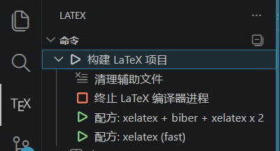

<div align="center">

**西北工业大学本硕博论文 LaTeX 模板**

***NwpuThesis***

[](https://github.com/1195343015/nwputhesis/actions/workflows/test.yml)
[](https://www.tug.org/texlive/)
[](https://nightly.link/1195343015/nwputhesis/workflows/test/main/nwputhesis-pdf-tl2026.zip)
[](https://www.gnu.org/licenses/gpl-3.0)

</div>

> 强烈推荐使用 Typst 模板 **[modern-npu-thesis](https://github.com/1195343015/modern-npu-thesis)**，语法更简洁，编译更快。

硕博格式符合 [研究生学位论文写作指南](https://gs.nwpu.edu.cn/info/2283/30467.htm)，本科格式符合 [本科毕业设计（论文）撰写规范](https://jiaowu.nwpu.edu.cn/info/1160/24598.htm)。

> **近期更新**：编译产物统一输出到 `build/` 目录，根目录不再产生中间文件；`master.tex` 和 `phd.tex` 已合并为 `graduate.tex`；原根目录 `thesis-body.tex` 已拆分至 `content/thesis/undergraduate/` 和 `content/thesis/graduate/` 下。

## 使用说明

本项目是一个可直接编译的西北工业大学本科、硕士、博士论文 LaTeX 模板。日常使用时通常只需要改 `content/` 目录下的论文内容文件，根目录的 `bachelor.tex`、`graduate.tex` 和 `nwputhesis.cls` 主要负责选择论文类型和加载模板。

### 1. 获取项目与字体

克隆或 Fork 本仓库后，先进入项目目录：

```bash
cd nwputhesis
```

本模板支持自动检测字体，优先级为 `fonts/` 本地字体、Windows 系统字体、TeX Live 自带 Fandol 字体。若 `fonts/` 目录缺少字体文件，执行：

```bash
git submodule update --init
```

也可以在入口文件的 `\documentclass[...]` 中显式指定字体：

```tex
fontset = local   % 使用 fonts/ 目录字体
fontset = windows % 使用 Windows 系统字体
fontset = fandol  % 使用 TeX Live 自带 Fandol 字体
```

### 2. 安装编译环境

- 推荐使用 TeX Live 2025 或 2026。
- 需要 `xelatex`、`latexmk`、`biber`、`biblatex` 和 `biblatex-gb7714-2015` 等常见宏包。
- 推荐编辑器为 VS Code + LaTeX Workshop 插件。
- 项目自带 `.latexmkrc`，会使用 XeLaTeX 编译，并把所有产物输出到 `build/`。
- `.latexmkrc` 中启用了 `-shell-escape`，如果你的 TeX 环境默认禁用它，请在确认模板来源可信后允许该选项。

### 3. 选择入口文件

| 入口文件 | 适用场景 | 内容目录 | 输出 PDF |
| --- | --- | --- | --- |
| `bachelor.tex` | 本科毕业设计论文 | `content/thesis/undergraduate/` | `build/bachelor.pdf` |
| `graduate.tex` | 硕士、博士学位论文 | `content/thesis/graduate/` | `build/graduate.pdf` |

本科直接编译 `bachelor.tex`。硕士/博士编译 `graduate.tex`，通过 `degree` 选项区分学位类型。

### 4. 设置论文类型

本科入口文件示例：

```tex
\documentclass[
    degree = bachelor,
    blindreview = false,
    bibindent = none,
    printmode = true,
]{nwputhesis}
```

研究生入口文件示例：

```tex
\documentclass[
    degree = master,
    academic = true,
    blindreview = false,
    colorcover = true,
    listfigures = false,
    bibindent = firstline,
]{nwputhesis}
```

常用选项说明：

| 选项 | 可选值 | 说明 |
| --- | --- | --- |
| `degree` | `bachelor` / `master` / `phd` | 论文类型，本科/硕士/博士 |
| `academic` | `true` / `false` | 研究生学术学位或专业学位，仅硕博有效 |
| `blindreview` | `true` / `false` | 盲审模式，会隐藏作者、导师信息及致谢 |
| `colorcover` | `true` / `false` | 是否使用彩色封面封底，仅硕博有效 |
| `listfigures` | `true` / `false` | 是否生成图目录和表目录，仅硕博有效 |
| `bibindent` | `firstline` / `none` / `hanging` | 参考文献缩进方式 |
| `printmode` | `true` / `false` | 本科双面印刷模式，使各部分从奇数页开始 |
| `fontset` | `local` / `windows` / `fandol` | 手动指定字体来源；不写时自动检测 |
| `bibstyle` | `2015` / `2025` | 参考文献标准，默认 `2015` |

### 5. 填写个人信息

研究生修改：

```text
content/thesis/graduate/info.tex
```

本科修改：

```text
content/thesis/undergraduate/info.tex
```

个人信息统一写在 `\nwputhesissetup{...}` 中。研究生常用字段：

```tex
\nwputhesissetup{
    class-number = {TP311.1},
    student-number = {2023123456},
    title = {中文题目},
    title* = {English Title},
    author = {中文姓名},
    author* = {English Name},
    year = {2026},
    month = {6},
    school = {计算机学院},
    major = {计算机技术},
    major* = {Computer Technology},
    advisor = {导师姓名},
    advisor* = {Advisor Name},
    advisor-rank = {教授},
}
```

本科常用字段：

```tex
\nwputhesissetup{
    title = {中文题目},
    title-line-a = {手动断行第一行},
    title-line-b = {手动断行第二行},
    major = {计算机科学与技术},
    author = {学生姓名},
    advisor = {指导教师},
    year = {2026},
    month = {6},
}
```

说明：

- `title` 支持自动换行；如果需要手动控制题目断行，使用 `title-line-a` 和 `title-line-b`。
- `major` 会尽量自动匹配英文专业名；若自动结果不符合要求，用 `major*` 或 `major-en` 覆盖。
- `advisor-rank` 会尽量自动匹配英文职称；若需要手动指定，用 `advisor-rank*` 或 `advisor-rank-en`。
- `month` 只能写 `1` 到 `12` 的整数。
- 研究生可设置 `class-number`、`student-number`、`school-code`、`security-level` 等封面字段。

### 6. 编写摘要、正文和后置内容

研究生主要文件：

| 文件 | 用途 |
| --- | --- |
| `content/thesis/graduate/abstract.tex` | 中文摘要、英文摘要、关键词、基金资助 |
| `content/thesis/graduate/committee.tex` | 学位论文评阅人和答辩委员会 |
| `content/thesis/graduate/chapters.tex` | 正文章节汇总入口 |
| `content/thesis/graduate/chapter*.tex` | 各章正文 |
| `content/thesis/graduate/reference.bib` | 正文参考文献 |
| `content/thesis/graduate/appendix.tex` | 附录 |
| `content/thesis/graduate/acknowledgements.tex` | 致谢，盲审模式自动隐藏 |
| `content/thesis/graduate/accomplishments.tex` | 参加科研情况 |
| `content/thesis/graduate/accomplishments.bib` | 科研成果 BibLaTeX 数据 |

本科主要文件：

| 文件 | 用途 |
| --- | --- |
| `content/thesis/undergraduate/abstract.tex` | 中文摘要、英文摘要、关键词 |
| `content/thesis/undergraduate/chapters.tex` | 正文章节汇总入口 |
| `content/thesis/undergraduate/chapter*.tex` | 各章正文 |
| `content/thesis/undergraduate/reference.bib` | 参考文献 |
| `content/thesis/undergraduate/acknowledgements.tex` | 致谢，盲审模式自动隐藏 |
| `content/thesis/undergraduate/designsummary.tex` | 毕业设计小结 |
| `content/thesis/undergraduate/appendix.tex` | 附录 |

新增章节时，新建一个章节文件，例如：

```text
content/thesis/graduate/chapter7.tex
```

然后在 `content/thesis/graduate/chapters.tex` 中加入：

```tex
\input{content/thesis/graduate/chapter7}
```

### 7. 摘要和关键词

摘要文件中使用标准环境：

```tex
\begin{abstract}
    中文摘要内容……
    \keywordslist{关键词一, 关键词二, 关键词三}
\end{abstract}

\begin{engabstract}
    English abstract...
    \engkeywordslist{keyword one, keyword two, keyword three}
\end{engabstract}
```

研究生论文的基金资助信息也在 `content/thesis/graduate/abstract.tex` 中设置：

```tex
\nwputhesissetup{
    funding = {本研究得到某某基金资助。},
    funding* = {The present work is supported by ...},
}
```

### 8. 参考文献

本项目使用 `biblatex + biber`，不是传统 BibTeX。正文参考文献文件为：

```text
content/thesis/graduate/reference.bib
content/thesis/undergraduate/reference.bib
```

正文中使用：

```tex
\cite{文献key}
```

不要手动写 `\bibliography{...}`，模板已经在 `thesis-body.tex` 中通过 `\addbibresource{...}` 和 `\printbibliography` 配置好了。修改 `.bib` 文件后，需要使用完整编译流程，或在 VS Code 中选择带 `biber` 的 recipe。

研究生“参加科研情况”使用单独的：

```text
content/thesis/graduate/accomplishments.bib
```

在 `content/thesis/graduate/accomplishments.tex` 中用：

```tex
\addpub{成果key}
\printaccomplishments
```

### 9. 插图和附件

图片建议放在：

```text
content/figures/
```

正文中可以直接引用文件名：

```tex
\begin{figure}[htbp]
    \centering
    \includegraphics[width=.8\textwidth]{example.png}
    \caption{图片标题}
    \label{fig:example}
\end{figure}
```

硕博提交最终版时，如果需要签字版声明页，将扫描得到的 PDF 替换：

```text
content/figures/研究生学位论文使用授权声明.pdf
```

`content/thesis/graduate/thesis-body.tex` 会在文末用 `\includepdf` 自动插入该文件。

### 10. 编译方式

推荐使用 VS Code 的 LaTeX Workshop 插件。项目已经配置好两个 recipe：

- **xelatex + biber + xelatex x 2**：完整编译，修改参考文献、目录、交叉引用后使用。
- **xelatex (fast)**：快速编译，日常只改正文时使用。



命令行编译本科论文：

```bash
latexmk bachelor.tex
```

命令行编译研究生论文：

```bash
latexmk graduate.tex
```

如果不用 `latexmk`，手动流程为：

```bash
mkdir -p build
xelatex -synctex=1 -interaction=nonstopmode -file-line-error -shell-escape -output-directory=build graduate.tex
biber build/graduate
xelatex -synctex=1 -interaction=nonstopmode -file-line-error -shell-escape -output-directory=build graduate.tex
xelatex -synctex=1 -interaction=nonstopmode -file-line-error -shell-escape -output-directory=build graduate.tex
```

本科手动编译时把 `graduate` 换成 `bachelor`。手动流程通过 `-output-directory=build` 让 `.aux`、`.bcf` 和 PDF 都进入 `build/`，所以 `biber` 也应处理 `build/` 下的文件。

### 11. 输出与清理

- 编译产物统一位于 `build/`。
- 本科 PDF：`build/bachelor.pdf`。
- 研究生 PDF：`build/graduate.pdf`。
- `build/` 已被 `.gitignore` 忽略，通常不需要提交。
- 清理中间文件可执行：

```bash
latexmk -C
```

### 12. 常见问题

- `biber` 找不到或参考文献不更新：确认安装了 `biber`，并使用完整 recipe 或执行 `latexmk graduate.tex` / `latexmk bachelor.tex`。
- 字体报错：先运行 `git submodule update --init` 获取 `fonts/`，或在 `\documentclass` 中指定 `fontset = fandol`。
- 目录、引用、图表编号不更新：完整编译一次，不要只跑快速 recipe。
- 盲审版仍出现个人信息：检查姓名、学号、导师等是否写在模板字段外；致谢在 `blindreview = true` 时会自动隐藏。
- 本科页面空白较多：检查 `printmode = true` 是否符合当前打印需求；双面印刷模式会让部分结构从奇数页开始。

## QQ交流群


## 推荐项目

[awesome-ai-research-writing](https://github.com/Leey21/awesome-ai-research-writing) | [AI-Research-SKILLs](https://github.com/Orchestra-Research/AI-Research-SKILLs)

## 许可证

本项目的硕博格式基于 [Yet-Another-LaTeX-Template-for-NPU-Thesis](https://github.com/NWPUMetaphysicsOffice/Yet-Another-LaTeX-Template-for-NPU-Thesis) 修改，本科格式参考了 [LaTeX-Template-For-NPU-Thesis](https://github.com/polossk/LaTeX-Template-For-NPU-Thesis)、[LaTeX-NewTemplate-For-NPU-undergraduate-Thesis](https://github.com/jialinlvcn/LaTeX-NewTemplate-For-NPU-undergraduate-Thesis) 和 [NWPU-Thesis-Template](https://github.com/lihanshu/NWPU-Thesis-Template)，整体实现参考了 [thuthesis](https://github.com/tuna/thuthesis)。

本项目采用 [GNU General Public License v3.0](LICENSE) 许可证发布。

Copyright (c) 2016-2022 NWPU Metaphysics Office https://github.com/NWPUMetaphysicsOffice

Modified (c) 2026 by Jiayi Yan https://github.com/1195343015
